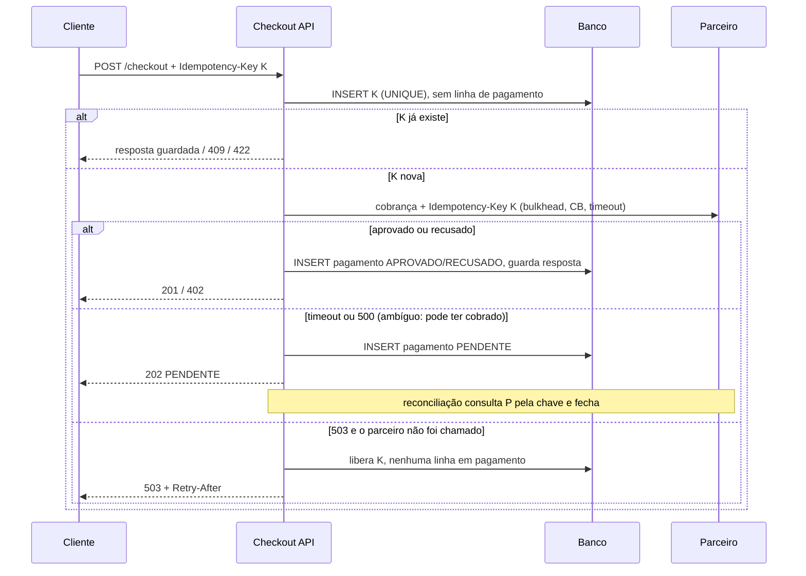

# Anexo da Aula 2 — padrões, chave e testes

O texto principal responde cada pergunta em poucas linhas. Aqui ficam a tabela dos padrões, o YAML, o ciclo da chave, o diagrama e os cenários de teste. A regra da linha de pagamento é a [regra única](../Aula%204/apendice-maquina-de-estados.md#linha-de-pagamento).

<a id="paradigma"></a>
## Paradigma

Spring MVC com threads virtuais (`spring.threads.virtual.enabled=true`, Spring Boot 3.2+, Java 21).

A carga é de espera, não de CPU. Cada checkout passa a maior parte do tempo esperando o parceiro. Uma requisição bloqueada em I/O solta a thread real do sistema operacional; 10 mil esperas simultâneas custam memória, não 10 mil threads de SO.

O código continua imperativo: `try/catch`, stack trace legível, JDBC e Resilience4j sem adaptação. O time vem de Python/Go e está começando em Java. WebFlux foi descartado: não há streaming (SSE, WebSocket) nem backpressure até o banco (R2DBC). É um POST que espera uma resposta. Os números de throughput do material ("30-40%", "~1000 threads") não têm cenário; só um teste de carga nosso decidiria.

Com threads de espera baratas, quem limita são o pool de conexões (o HikariCP vem com 10 por padrão) e a cota do parceiro. Nenhuma conexão ou transação fica aberta durante a chamada. O Bulkhead limita quantas chamadas simultâneas vão ao parceiro.

No Java 21, `synchronized` em volta de I/O prende a thread virtual na thread real (pinning). Usar `ReentrantLock` nesses pontos. O JDK 24 resolveu isso (JEP 491).

<a id="padroes"></a>
## Padrões

Ordem padrão das anotações do Resilience4j: `Retry ( CircuitBreaker ( RateLimiter ( TimeLimiter ( Bulkhead ( chamada ) ) ) ) )`.

| Padrão | Usa? | Por quê |
|---|---|---|
| **Timeout** (no cliente HTTP) | Sim | Sem limite, um parceiro lento segura a requisição para sempre. `connectTimeout` e timeout de resposta explícitos no cliente HTTP (ex.: 1 s e 2 s, valores iniciais). |
| **TimeLimiter** | Não, no caminho síncrono | A anotação só funciona com `CompletableFuture`/tipos reativos, e cancelar o futuro não interrompe a chamada bloqueante que roda por baixo. Com MVC + cliente bloqueante, quem corta a espera e libera a thread é o timeout do cliente HTTP. |
| **CircuitBreaker** | Sim | Parceiro doente: paramos de chamar por um tempo e respondemos rápido, em vez de empilhar 10 mil esperas de 2 s. Conta como falha: 5xx, timeout e erro de conexão. Não conta: recusa do cartão (402), nem `BulkheadFullException`, nem `RequestNotPermitted`. Essas duas saem antes da chamada. |
| **Retry** | Sim, restrito | Só erro de conexão antes de enviar (`ConnectException`) e 503/429, sempre com a mesma chave de idempotência. Máximo 3 tentativas, backoff exponencial com jitter. Nunca repete timeout de leitura nem 500, nem 4xx. |
| **Bulkhead** (semáforo) | Sim | Limita chamadas simultâneas ao parceiro (ex.: 200). Semáforo, não pool de threads: com threads virtuais, não há pool a proteger. |
| **RateLimiter** | Sim, na saída | A cota do contrato é um número para a frota inteira. Cada réplica fica com `cota / número de réplicas`, e o gateway segura a cota cheia. Exemplo: contrato de 500/s e 10 réplicas → 50/s em cada uma, e 500/s no gateway. Na entrada, limite por cliente com 429 é opcional, de preferência nesse mesmo gateway. |

Fallback: na dúvida, nega; falha nunca vira "aprovado".

- Circuito aberto, bulkhead cheio ou rate limit estourado: sabemos que não chamamos o parceiro. Responde `503` com `Retry-After`; o cliente pode tentar de novo com a mesma chave.
- Timeout ou 500 depois de enviar: não sabemos se cobrou. O pagamento fica `PENDENTE` e a resposta é `202 { "status": "PENDENTE" }`. Um job de reconciliação consulta o parceiro pela chave do pedido e fecha em `APROVADO`, `RECUSADO` ou `EXPIRADO`. O fechamento só sai de `PENDENTE` (`UPDATE ... WHERE status = 'PENDENTE'`). A única exceção é a [regra única](../Aula%204/apendice-maquina-de-estados.md#linha-de-pagamento): o webhook de captura depois de `EXPIRADO` muda `pagamento.status` de `EXPIRADO` para `APROVADO`, e o pedido em `CANCELADO_SEM_COBRANCA` vai para `ESTORNANDO`.

Valores iniciais de exemplo, a calibrar com métrica real (p99 do parceiro, taxa de erro).

```yaml
resilience4j:
  circuitbreaker.instances.parceiro:
    sliding-window-type: COUNT_BASED
    sliding-window-size: 50
    minimum-number-of-calls: 20
    failure-rate-threshold: 50          # % de falhas para abrir
    slow-call-duration-threshold: 1500ms
    slow-call-rate-threshold: 60        # % de chamadas lentas para abrir
    wait-duration-in-open-state: 30s
    permitted-number-of-calls-in-half-open-state: 5
    ignore-exceptions:
      - com.loja.checkout.CartaoRecusadoException
      - io.github.resilience4j.bulkhead.BulkheadFullException
      - io.github.resilience4j.ratelimiter.RequestNotPermitted
  retry.instances.parceiro:
    max-attempts: 3                     # inclui a primeira chamada
    wait-duration: 200ms
    enable-exponential-backoff: true
    enable-randomized-wait: true        # jitter
    retry-exceptions: [java.net.ConnectException, com.loja.checkout.ParceiroIndisponivelException]
  bulkhead.instances.parceiro:
    max-concurrent-calls: 200
    max-wait-duration: 50ms
  ratelimiter.instances.parceiro:
    limit-for-period: 50               # cota do contrato / réplicas (ex.: 500/s ÷ 10)
    limit-refresh-period: 1s
    timeout-duration: 0                # não espera vaga: 503 na hora
```

<a id="idempotencia"></a>
## Idempotência

A chave é da intenção, não da tentativa. O cliente gera um UUID quando o usuário confirma o checkout e reenvia a mesma chave em toda tentativa. Sem o cabeçalho: `400`.

1. Chega: o servidor tenta `INSERT` em `idempotency_keys (chave, hash_do_corpo, status=EM_PROCESSAMENTO, resposta=null, expira_em)`. A chave é `UNIQUE`: a gravação atômica decide quem é o primeiro.
2. Repetição: mesma chave + mesmo hash e já concluída → devolve a resposta guardada, com o status original (201, 402 ou 202; se era 202, devolve o estado atual do pagamento). Mesma chave + corpo diferente → `422`. Ainda `EM_PROCESSAMENTO` → `409`, sem chamar o parceiro.
3. Parceiro: a mesma chave (ou o `orderId` derivado dela) vai no `Idempotency-Key` do parceiro.
4. Falha sem cobrança (503 em que o parceiro não foi chamado: circuito aberto, bulkhead cheio ou rate limit): a chave é liberada e não nasce linha em `pagamento`. Falha ambígua (timeout ou 500 depois de enviar): grava o pagamento `PENDENTE` e a chave fica ligada a ele.
5. Expira: TTL de 24 h. Depois disso a linha pode ser apagada, mas o `order_id` único na tabela de pagamentos continua barrando a segunda cobrança do mesmo pedido.

Um prazo (`travado_ate`) no `EM_PROCESSAMENTO` evita chave presa se a réplica cair no meio da chamada. Vencido o prazo, a reconciliação consulta o parceiro pela mesma chave. Se ele tiver a cobrança, grava o pagamento (final ou `PENDENTE`). Se não tiver, libera a chave. Não se grava `PENDENTE` antes de saber que a chamada saiu.

| Tabela | Campos | Constraints |
|---|---|---|
| `idempotency_keys` | `id uuid`, `chave uuid`, `hash_do_corpo text`, `status text`, `order_id uuid`, `resposta_status int`, `resposta jsonb`, `travado_ate timestamptz`, `expira_em timestamptz` | `UNIQUE (chave)`; `CHECK (status IN ('EM_PROCESSAMENTO','CONCLUIDA'))`; `resposta` nula até concluir; `expira_em` = criação + 24 h. |
| `pagamento` | `id uuid`, `order_id uuid`, `valor numeric(12,2)`, `status text`, `version bigint` | `UNIQUE (order_id)`; `CHECK (status IN ('PENDENTE','AGUARDANDO_CAPTURA','APROVADO','RECUSADO','EXPIRADO'))`, o mesmo das Aulas 3 e 4. |

Cartão recusado encerra a compra. Um `402` é resposta final daquela chave: repetir devolve o mesmo `402`; trocar o cartão com a mesma chave muda o corpo e dá `422`. Outro cartão é um checkout novo, com chave nova e pedido novo.



Este diagrama é o caminho síncrono (cartão), antes do Pix com QR. `AGUARDANDO_CAPTURA` nasce quando o QR é criado, na Aula 4. A exceção `EXPIRADO` → `APROVADO` está na [regra única](../Aula%204/apendice-maquina-de-estados.md#linha-de-pagamento). Sem linha e com cobrança no parceiro, a reconciliação insere a linha. Com linha `PENDENTE`, só fecha.

<a id="testes"></a>
## Testes

WireMock no lugar do parceiro, num teste de integração com o Spring de verdade (as anotações moram no proxy; teste de unidade com `new` não pega). Para falha de rede real, Testcontainers + Toxiproxy (latência, `reset_peer`). Cada teste nasce vermelho: escrito antes da configuração, tem de falhar sem ela.

| Cenário injetado | O que o teste afirma |
|---|---|
| Latência de 10 s (`withFixedDelay(10_000)`) | A resposta volta em ~2 s (timeout + margem), com `202 PENDENTE`; nunca `201`. Depois, as vagas do bulkhead voltam ao máximo: a thread foi liberada. |
| 500 / conexão derrubada (`withFault(CONNECTION_RESET_BY_PEER)`) repetidos | Após `minimum-number-of-calls` com taxa acima do limite, o estado vai a `OPEN` (lido no `CircuitBreakerRegistry`). |
| Circuito aberto | A próxima chamada responde `503` em poucos ms e o WireMock não recebe requisição nova (`verify(exactly(n), ...)`). |
| Recuperação (no teste, `wait-duration-in-open-state` curto) | Stub volta a `200`, o estado passa a `HALF_OPEN` e, com as chamadas de teste ok, `CLOSED`. |
| 503 seguido de 200 (cenários do WireMock) | Houve retry e cada tentativa levou a mesma chave: `verify(postRequestedFor(urlEqualTo("/charges")).withHeader("Idempotency-Key", equalTo(k)))`, e nenhuma com chave diferente. Timeout: exatamente 1 chamada ao parceiro. |
| Duas requisições simultâneas com a mesma chave | Uma `201`, uma `409`; o parceiro recebe 1 chamada. |
| Recusa (`402`) repetida | O circuito continua `CLOSED`: recusa não é falha técnica. |
| Recusa e depois outro cartão com a mesma chave | `422`; o WireMock não recebe nova cobrança. |

O WireMock devolve o que mandamos. Ele não prova que o parceiro real deduplica pela chave, nem como ele responde a um timeout. Há também um teste de contrato no sandbox do parceiro: mesma chave duas vezes → uma cobrança só; e a consulta usada pela reconciliação devolve o estado esperado.
