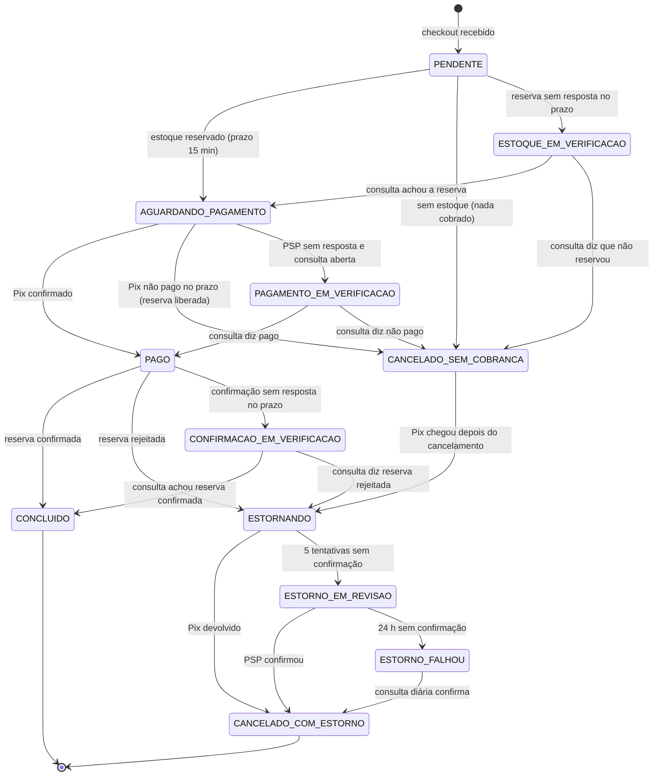

# Apêndice: máquina de estados do pedido

Referência única das Aulas 4, 5 e 6. O mesmo pedido, o mesmo nome para a mesma situação de dinheiro e de estoque. Se um desenho divergir daqui, vale este arquivo.

**Resposta curta.** O pedido reserva o estoque antes de cobrar. Cada estado diz, ao mesmo tempo, se o dinheiro se moveu e o que aconteceu com a unidade. Não existe estado "cancelado com Pix retido".

**Por quê.** Um nome só para situações diferentes esconde o dinheiro. Foi o que `CANCELADO` fazia: servia para "não havia unidade", para "o Pix venceu sem pagamento" e para "o Pix foi devolvido". Quem lia o pedido não sabia se precisava devolver alguma coisa.

**Exemplo.** A última TV é reservada, o cliente não paga no prazo, a reserva volta para a prateleira: `CANCELADO_SEM_COBRANCA`. Outro cliente paga, a reserva já expirou e a unidade foi vendida: o Pix volta e o pedido termina `CANCELADO_COM_ESTORNO`. Os dois são "cancelados" para a tela. Para o financeiro, são o oposto.

## O que aconteceu com os nomes antigos

| Nome que apareceu antes | O que ele era | Nome neste apêndice |
|---|---|---|
| `PENDENTE` da Aula 2 | Status da **linha de pagamento**, não do pedido. Só existe quando a chamada ao parceiro já saiu e a resposta é ambígua (timeout ou 500). | Continua `pagamento.status = PENDENTE`. O pedido, nesse meio-tempo, fica em `PAGAMENTO_EM_VERIFICACAO`. |
| `PENDENTE` da Aula 4 | Pedido recebido, reserva de estoque ainda sem resposta. | Continua `PENDENTE`. Se o prazo estoura e a consulta não fecha, vai para `ESTOQUE_EM_VERIFICACAO`. Não fica parado. |
| `CANCELADO` da Aula 4 | Um rótulo para três situações. | Dividido: `CANCELADO_SEM_COBRANCA`, `CANCELADO_COM_ESTORNO`, ou nem chega a cancelar (`ESTORNANDO` / `ESTORNO_EM_REVISAO` / `ESTORNO_FALHOU`). |
| `AGUARDANDO_PIX`, `CONFIRMADO`, `RESERVANDO_ESTOQUE` (textos das Aulas 5 e 6) | Sinônimos da mesma situação, com outro nome. | `AGUARDANDO_PAGAMENTO`, `CONCLUIDO`, `PENDENTE`. |
| Cinco tentativas de estorno (Aula 4) | O laço automático. Depois da quinta sem confirmação, revisão e chamado. | **Continua valendo.** É o que abre `ESTORNO_EM_REVISAO`. Não foi substituído. |
| Prazo de 24 h (Aula 6) | Não havia prazo na revisão: o chamado humano podia ficar sem fim. | **Acrescenta o fim da revisão.** 24 h em `ESTORNO_EM_REVISAO` sem confirmação do PSP abrem `ESTORNO_FALHOU`. O chamado segue aberto. O job consulta o PSP uma vez por dia e, se a devolução existir, fecha em `CANCELADO_COM_ESTORNO` sem pedir o estorno de novo. |

`Aula 4/desafio/SagaCompra.java` imprime `CANCELADO_SEM_COBRANCA` quando nada foi cobrado e `CANCELADO_COM_ESTORNO` quando o Pix foi devolvido. A Aula 6 grava `PENDENTE`, `AGUARDANDO_PAGAMENTO` e `CONCLUIDO`. O laboratório da Aula 5, no backfill do H2, ainda copia o token antigo `CONFIRMADO` para `estado_saga` (o teste espera esse valor); no mapa de produção, `CONFIRMADO` vira `CONCLUIDO`.

## Estados

Prazo de cada passo não final: `prazo_passo`. O exemplo usado no desenho é 30 s para uma resposta de serviço e 15 min para o cliente pagar o Pix. `PAGO` entra nesse prazo: sem ele, um pedido cobrado cuja reserva não responde fica cobrado para sempre.

| Estado | Dinheiro | Estoque | Sai sozinho? |
|---|---|---|---|
| `PENDENTE` | nada cobrado | reserva ainda não respondida | não |
| `ESTOQUE_EM_VERIFICACAO` | nada cobrado | timeout e a consulta da reserva não fechou | não |
| `AGUARDANDO_PAGAMENTO` | Pix gerado, não capturado | reserva `ATIVA`, com prazo | não |
| `PAGAMENTO_EM_VERIFICACAO` | pode ter sido capturado; a consulta não fechou | reserva `ATIVA` | não |
| `PAGO` | capturado | confirmação da reserva ainda no prazo | não |
| `CONFIRMACAO_EM_VERIFICACAO` | capturado | a confirmação não respondeu e a consulta não fechou | não |
| `CONCLUIDO` | capturado | reserva `CONFIRMADA` | sim, fim |
| `CANCELADO_SEM_COBRANCA` | nada capturado | sem reserva, ou reserva `LIBERADA` | fim, salvo Pix atrasado |
| `ESTORNANDO` | capturado; estorno pedido, dentro das 5 tentativas | reserva rejeitada ou `LIBERADA` | não |
| `ESTORNO_EM_REVISAO` | capturado; PSP ainda não confirmou a devolução | `LIBERADA` | não |
| `ESTORNO_FALHOU` | capturado; 24 h sem confirmação; chamado aberto | `LIBERADA` | não; o job diário ainda fecha |
| `CANCELADO_COM_ESTORNO` | devolução confirmada pelo PSP | `LIBERADA` | sim, fim |

Toda transição é condicional: `UPDATE pedidos SET status = :novo, version = version + 1 WHERE id = :id AND status = :esperado`. Zero linhas significam mensagem velha ou repetida, com uma exceção: `PagamentoAprovado` com o pedido já em `CANCELADO_SEM_COBRANCA` não é descarte. O dinheiro entrou. O pedido vai para `ESTORNANDO`.

## Política de prazo, tentativa e estorno

1. O job de prazos varre todo estado que não é fim e cujo `prazo_passo` venceu. Isso inclui `PAGO`.
2. O job **não cria mensagem nova**. Reenvia o mesmo comando: o mesmo `message_id` (chave estável `pedido_id` + tipo do passo) e a mesma chave de negócio (no estorno, o id do pagamento). Um `message_id` novo passaria na chave de `mensagens_processadas` e executaria o efeito outra vez.
3. Timeout não é falha. Antes de decidir, o job consulta o participante (Estoque pela reserva, PSP pelo pagamento ou pelo estorno). Status desconhecido cai no estado `*_EM_VERIFICACAO` correspondente. Não confirma, não cancela e não estorna no escuro.
4. Estorno: até 5 tentativas, com espera 1 s, 5 s, 30 s, 2 min, 10 min, sempre a mesma chave. Na quinta sem confirmação, `ESTORNO_EM_REVISAO`, mensagem na DLQ e chamado. O cliente vê "devolução em análise".
5. 24 h nesse estado sem confirmação: `ESTORNO_FALHOU`. O chamado continua. A consulta diária ainda pode concluir a devolução. As cinco tentativas abrem a revisão; as 24 h impedem que a revisão não tenha fim. Uma não substitui a outra.
